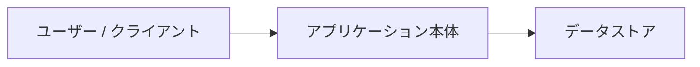
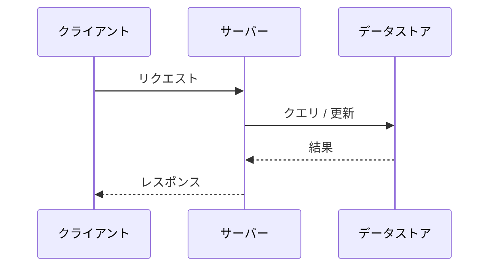

# システムアーキテクチャ

<!-- 冒頭に対象・要点・適用範囲を短く説明。該当しない項目・例は削除し、根拠へのリンクを添える。 -->

<!-- 全体構成と責務・境界を示し、詳細は必要に応じて別文書へリンクします。 -->

## 1. 全体構成図

## 2. 技術スタック

| レイヤー / 用途 | 採用技術 | 採用理由・備考 |
|---|---|---|
| 言語 / ランタイム | | |
| フレームワーク | | |
| データストア | | |
| テスト / Lint | | |

## 3. ディレクトリ・モジュール構成と責務

| パス / モジュール | 責務 | 依存してよい対象（境界ルール） |
|---|---|---|
| `src/...` | | |

### モジュール境界の制約（重要）
<!-- AIがレイヤー違反のコードを書かないよう、禁止する依存方向を明記します -->
- 

## 4. 主要なデータフロー

## 5. 横断的関心事（エラー処理・ログ・セキュリティ・設定管理）

- **エラーハンドリング方針**:
- **設定・環境変数の扱い**:
- **ロギング・監視**:

## 未確認事項

<!-- 推測・未決定の事項がある場合は、プレビューで見える本文として記載。なければこの節を削除 -->
